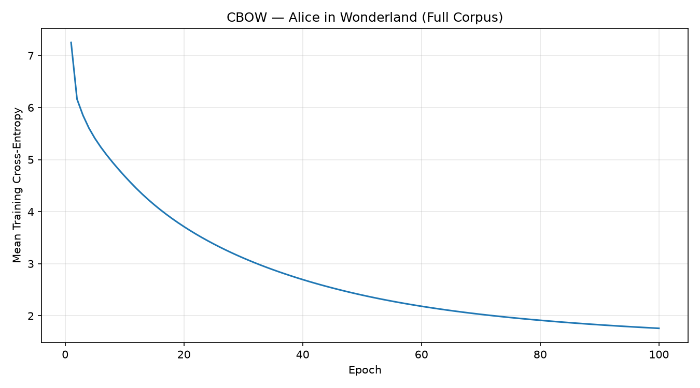
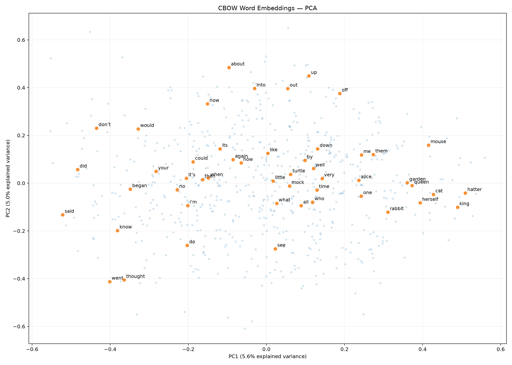

# CBOW Word2Vec — From Scratch with NumPy

A from-scratch implementation of **Continuous Bag-of-Words (CBOW)** using NumPy, with **manually implemented backpropagation**, finite-difference gradient checks, and reproducible word-embedding experiments.

This project is intended as a transparent, educational implementation of a classical neural language model: the forward pass, loss, gradients, and parameter updates are written explicitly. **No PyTorch, TensorFlow, or automatic differentiation is used for training.**

## Highlights

- CBOW with averaged context embeddings and a **full-vocabulary softmax**.
- Manual gradients for the input and output weight matrices.
- Numerically stable softmax and cross-entropy via **log-sum-exp**.
- Finite-difference gradient checking and automated tests with `pytest`.
- Seed-controlled initialization and optional per-epoch SGD shuffling.
- Training-loss tracking, cosine nearest-neighbor search, frequency filtering, and PCA visualization.
- Saved reference experiment on *Alice's Adventures in Wonderland*.

## How it works

Given a target word and its surrounding context, CBOW learns to **predict the target from the context**.

For vocabulary size $V$, embedding dimension $d$, and context of $C$ words, the model uses:

| Symbol | Shape | Meaning |
| --- | --- | --- |
| $\mathbf{x}$ | $1 \times V$ | Normalized bag-of-words context vector |
| $W_{\mathrm{in}}$ | $V \times d$ | Input embedding matrix |
| $\mathbf{h}$ | $1 \times d$ | Average context embedding |
| $W_{\mathrm{out}}$ | $d \times V$ | Output weight matrix |
| $\mathbf{z}$ | $1 \times V$ | Target-word logits |

The forward pass is

$$
\begin{aligned}
\mathbf{h} &= \mathbf{x}W_{\mathrm{in}},\\
\mathbf{z} &= \mathbf{h}W_{\mathrm{out}},\\
\hat{\mathbf{y}} &= \mathrm{softmax}(\mathbf{z}).
\end{aligned}
$$

For target-word index $t$, the loss is $L=-\log \hat{y}_t$. In code, it is evaluated **directly from the logits** using the numerically stable log-sum-exp formulation:

$$
L=-z_t+m+\log\sum_{j=1}^{V}\exp(z_j-m),
\qquad m=\max_j z_j.
$$

The backward pass uses the analytical derivatives

$$
\begin{aligned}
\frac{\partial L}{\partial \mathbf{z}}
&= \hat{\mathbf{y}}-\mathbf{y},\\
\frac{\partial L}{\partial W_{\mathrm{out}}}
&= \mathbf{h}^{\mathsf T}(\hat{\mathbf{y}}-\mathbf{y}),\\
\frac{\partial L}{\partial W_{\mathrm{in}}}
&= \mathbf{x}^{\mathsf T}
\bigl((\hat{\mathbf{y}}-\mathbf{y})W_{\mathrm{out}}^{\mathsf T}\bigr).
\end{aligned}
$$

See **[the full mathematical derivation](docs/math.md)** for the individual steps and tensor shapes.

## Saved experiment: Alice in Wonderland

The repository includes a reference checkpoint trained on Lewis Carroll's *Alice's Adventures in Wonderland* using the plain-text edition from [Project Gutenberg, ebook #11](https://www.gutenberg.org/ebooks/11).

| Setting | Saved run |
| --- | ---: |
| Tokens | 26,630 |
| Vocabulary size | 2,669 |
| Training pairs | 26,626 |
| Context window | 2 words on each side |
| Embedding dimension | 30 |
| Learning rate | 0.05 |
| Epochs | 100 |
| Optimization | Per-example SGD, original fixed example order |
| Recorded mean online loss, first epoch | 7.2496 |
| Recorded mean online loss, final epoch | 1.7602 |

> **Reference-run note:** These figures and the checkpoint were saved **before** the later training-loop refactor. The plotted values are mean *online SGD* losses, computed during parameter updates, rather than epoch-end evaluation losses. Updated training runs record both metrics. Exact results can also depend on the source-text edition and training configuration.

### Training loss



The saved training loss decreases substantially, showing that the model fits the training objective. This is **not** a held-out evaluation or a measure of general-purpose semantic quality.

### Nearest neighbors

Examples from the saved model, using cosine similarity between input embeddings:

| Query word | Neighbor 1 | Neighbor 2 |
| --- | --- | --- |
| `said` | `asked` (0.712) | `replied` (0.696) |
| `rabbit` | `hatter` (0.652) | `mouse` (0.617) |
| `king` | `hatter` (0.834) | `dormouse` (0.728) |

These are **illustrative**, not benchmark results. The corpus is small and some low-frequency tokens have unreliable vectors; the current evaluation script offers a minimum-frequency filter for candidate neighbors. The committed `neighbors.json` records the original saved evaluation.

### Embedding visualization



The visualization projects L2-normalized word embeddings to two dimensions using PCA. Because only a small fraction of the embedding variance is represented in 2D, proximity on this plot should not be overinterpreted.

## Installation

Requires **Python 3.11+**. From the repository root:

```bash
python -m pip install -e ".[dev]"
python -m pytest -q
```

Core training uses NumPy and tqdm. The optional `dev` dependencies provide pytest and the visualization packages (Matplotlib and scikit-learn).

## Run an experiment

### 1. Get the corpus

Download the **UTF-8 plain-text** version of [Project Gutenberg ebook #11](https://www.gutenberg.org/ebooks/11) and save it as:

```text
data/raw/alice.txt
```

The training script expects the Project Gutenberg `START` and `END` markers present in the source text; differently formatted editions may need corresponding adjustments. The raw text is not committed to the repository.

### 2. Train

A lightweight smoke test (run from the repository root):

```bash
python scripts/train_alice_full.py --max-tokens 500 --epochs 2 --seed 42 --shuffle --out-dir artifacts/smoke_test
```

A separate larger experiment, without overwriting the reference checkpoint:

```bash
python scripts/train_alice_full.py --window-size 2 --embedding-dim 30 --learning-rate 0.05 --epochs 100 --seed 42 --out-dir artifacts/alice_reproduction
```

**Note:** The full-vocabulary softmax and epoch-end loss evaluation are intentionally simple, but computationally expensive on the full corpus. The second command can require substantial computation.

### 3. Evaluate saved embeddings

```bash
python scripts/evaluate_alice.py --out-dir artifacts/smoke_test
```

The evaluation writes `neighbors.json` and `embeddings_pca.png` to the selected output directory. Each experiment also saves `model.npz`, `vocab.json`, `frequencies.json`, `metadata.json`, and a training-loss plot. Generated data arrays and transient experiments remain local by default.

### 4. Run the tiny demonstration

```bash
python scripts/run_training.py
```

This demonstrates CBOW on the sentence `The cat sits on the mat` and plots the loss together with an empirical lower bound for the observed context-target distribution.

## Correctness and testing

The test suite covers training-pair construction, context averaging (including duplicate words), softmax and cross-entropy behavior, numerical edge cases, reproducibility, and nearest-neighbor filtering.

Crucially, **finite-difference tests check both analytical weight gradients**:

$$
\frac{\partial L}{\partial w_{ij}}
\approx \frac{L(W+\varepsilon E_{ij})-L(W-\varepsilon E_{ij})}{2\varepsilon}.
$$

```bash
python -m pytest -q
python scripts/check_gradients.py
```

The tests are designed to fail if the analytical backward pass no longer matches the implemented loss. `check_gradients.py` is also retained as a standalone, inspectable demonstration.

## Repository layout

```text
src/cbow/                  Core data, model, training, metrics, and evaluation code
scripts/                   Training, evaluation, and gradient-checking entry points
tests/                     Automated checks
docs/math.md               Step-by-step mathematical derivation
examples/legacy/           Earlier experiment script, preserved for reference
artifacts/alice_full/      Curated model checkpoint and experiment outputs
pyproject.toml             Package configuration and dependencies
```

## Scope and limitations

This is an **educational, single-example SGD implementation** of CBOW rather than a production word-embedding pipeline. It uses a full softmax over the vocabulary; it does not implement negative sampling, hierarchical softmax, subsampling of frequent tokens, or large-scale batching. The saved Alice experiment has no held-out benchmark and should not be used to claim state-of-the-art embedding quality.

## License

Released under the [MIT License](LICENSE). Corpus text is distributed separately by Project Gutenberg under its own terms.